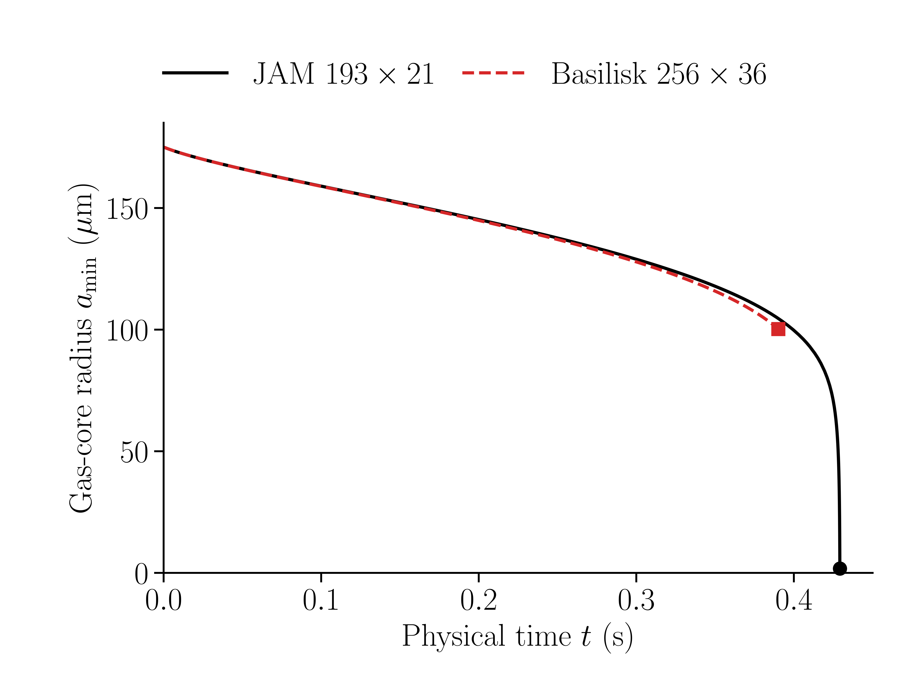
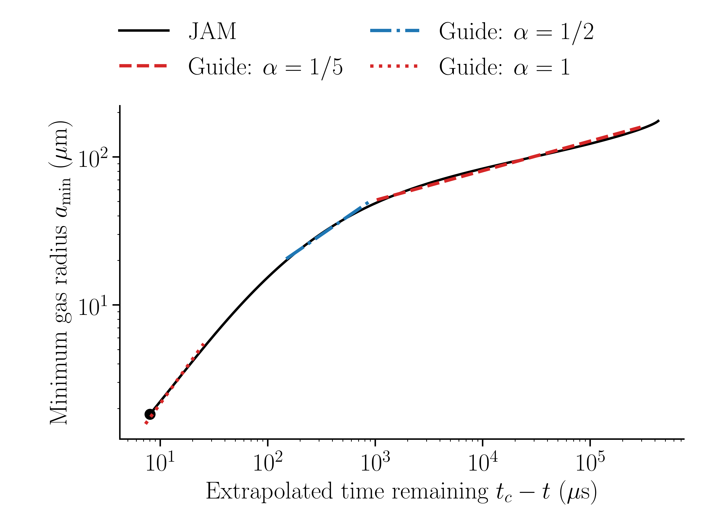
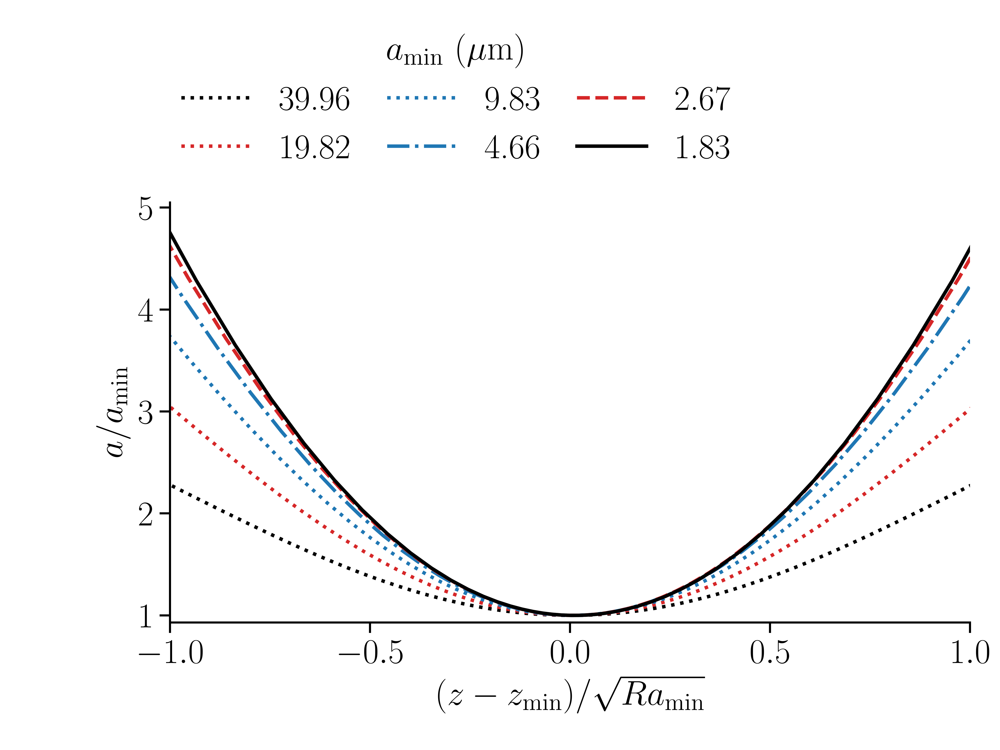

# Confined Bubble Pinch-Off

Axisymmetric gas-core thinning inside a liquid-lined circular tube, computed with the Jacobian Analytical Method (JAM). This repository contains a Newtonian comparison case, an 11-case viscoelastic screening matrix, and the Python solver used for the screening.

The tube has radius $R=250\,\mu\mathrm{m}$, a rigid no-slip wall, and an axial period $L/R=7.108612701$. The initial gas radius is $a/R=0.8+0.1\cos(2\pi z/L)$. Both phases retain inertia. The gas density and viscosity are $1\,\mathrm{kg\,m^{-3}}$ and $1.8\times10^{-5}\,\mathrm{Pa\,s}$.

## Newtonian result

The liquid density, viscosity, and surface tension are $1000\,\mathrm{kg\,m^{-3}}$, $0.05\,\mathrm{Pa\,s}$, and $0.02\,\mathrm{N\,m^{-1}}$. The $193\times21$ JAM run reached a gas-core radius of **1.83 μm at 0.42919231 s**, where it hit the adaptive step floor with the gas core still connected.

The red line is an archived $256\times36$ Basilisk snapshot. The two solvers use slightly different axial periods, with a relative difference of 0.0351%.

The JAM effective exponent is about **0.188** over 50–150 μm. A free fit over the final 1.83–4.66 μm gives **0.903**, with an extrapolated zero-radius time of **0.42920033 s**. A linear fit to that window gives a thinning speed of **0.193 m/s**. These are finite-window estimates from one late-stage grid.

| Time scaling | Neck profiles |
|---|---|
|  |  |

The profile plot uses $a/a_{\min}$ and $(z-z_{\min})/\sqrt{Ra_{\min}}$. The last three plotted frames have normalized half-widths of about 0.521–0.537 at $a=2a_{\min}$. The native last frame, scaling windows, and plotted JAM data are in [results/newtonian](results/newtonian).

The [plotting notebook](notebooks/液膜聚合.ipynb) includes the original comparison figure, the JAM/Basilisk remaining-time plot, and the normalized JAM neck profiles. Its saved figures can be viewed on GitHub. To rerun the plotting cells, open the notebook from a clone and use an environment with Jupyter, NumPy, Pandas, Matplotlib, and LaTeX with dvipng.

## Viscoelastic screening

All 11 cases start from rest with equilibrium conformation. The liquid density, zero-shear viscosity and surface tension are $1000\,\mathrm{kg\,m^{-3}}$, $1\,\mathrm{Pa\,s}$ and $0.04\,\mathrm{N\,m^{-1}}$. Case 1 uses $\mu_s=0.01\,\mathrm{Pa\,s}$, $\mu_p=0.99\,\mathrm{Pa\,s}$ and $\lambda=3\,\mathrm{s}$.

| Case | Model | Relaxation time (s) | Polymer viscosity fraction | $L^2$ |
|---:|---|---:|---:|---:|
| 1 | Oldroyd-B | 3 | 0.99 | ∞ |
| 2 | Oldroyd-B | 0.3 | 0.99 | ∞ |
| 3 | Oldroyd-B | 0.03 | 0.99 | ∞ |
| 4 | Oldroyd-B | 0.003 | 0.99 | ∞ |
| 5 | Oldroyd-B | 30 | 0.99 | ∞ |
| 6 | Oldroyd-B | 3 | 0.90 | ∞ |
| 7 | Oldroyd-B | 3 | 0.50 | ∞ |
| 8 | FENE-P | 3 | 0.99 | 30 |
| 9 | FENE-P | 3 | 0.99 | 300 |
| 10 | FENE-P | 0.03 | 0.99 | 30 |
| 11 | FENE-P | 0.03 | 0.99 | 300 |

The $97\times13$ screening runs couple all four axisymmetric liquid conformation components to the liquid momentum equations and interfacial traction. The accepted-step checks cover conformation positivity, FENE-P extensibility, divergence, gas volume, and wall velocity.

A gas-filament candidate has radius at most 12.5 μm. Its connected section with radius at most $1.2a_{\min}$ must span at least five neck diameters and 12 axial intervals. The conditions must persist for at least three accepted macrosteps over 20 μs. The [2026-11-05 screening snapshot](results/viscoelastic) covers startup for all 11 cases, with gas radii still about 175 μm.

## Run

Install the Python dependencies and run a small Case 1 smoke calculation from the repository root.

~~~bash
python -m pip install -r requirements.txt
python solver/run_viscoelastic.py --case 1 --ns 33 --ny 7 --max-steps 3 --output runs/case01-smoke
~~~

For the screening grid, omit the mesh and step overrides. Change the case number to select a row of [cases.json](solver/cases.json). The defaults bound a run to 28,000 wall seconds and 12 seconds of simulated time. The output directory should be new.

The Newtonian driver can reproduce the continuation from the archived BDF history at $t^*=484.5$. Set the deadline to a Unix epoch in the future and use an unused output path.

~~~bash
python solver/jam_continue.py --restart results/newtonian/late_restart.npz --output runs/newtonian-late --deadline 2000000000 --max-steps 1
~~~

## Sources

- The Chebyshev helper is from the [JAM project](https://github.com/miguelherrada/JAM), with its [MIT notice](third_party/JAM-LICENSE.txt).
- [Mao et al.](https://doi.org/10.1017/jfm.2026.11400) report a crossover from $1/5$ to linear thinning for a tube film without van der Waals forces.
- [How elasticity affects bubble pinch-off](https://arxiv.org/abs/2511.20075) compares the thinning of gas necks in dilute polymer solutions with air filaments observed at higher concentrations.
